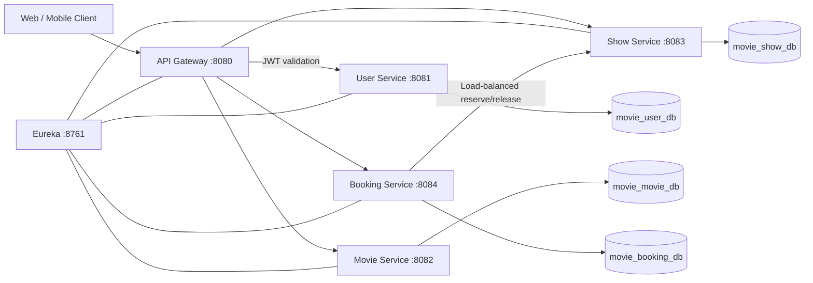

# CinePass architecture

## Responsibilities
- User: registration, password hashing and JWT issuance.
- Movie: independent movie catalogue CRUD.
- Show: show schedule and seat inventory; owns seat reservation lock.
- Booking: authenticated user booking history and cancellation; orchestrates seat reservation.
- Gateway: single ingress, JWT verification, identity propagation and route selection.
- Eureka: dynamic service registration/discovery.

## Booking sequence
1. Client authenticates and receives JWT.
2. Client posts showId + seatNumber to Gateway.
3. Gateway validates signature/expiry and propagates JWT subject as X-Authenticated-User.
4. Booking Service asks Show Service to reserve the seat.
5. Show Service locks the seat row (`PESSIMISTIC_WRITE`), checks availability and commits reservation.
6. Booking Service persists booking with authenticated identity. If persistence fails it requests compensating release.
7. Client receives booking record or an error.
