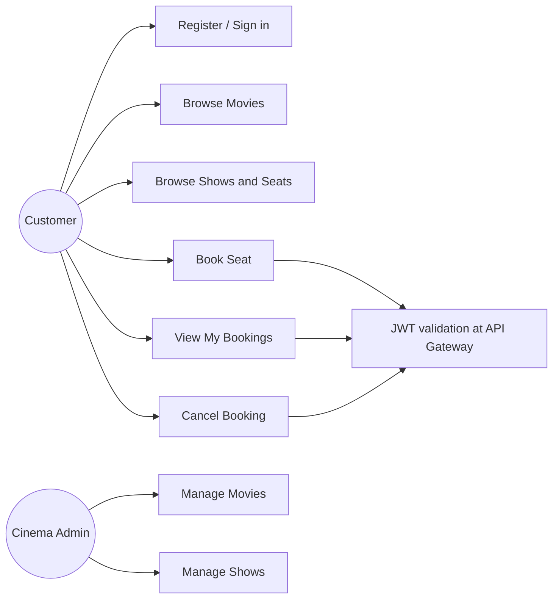
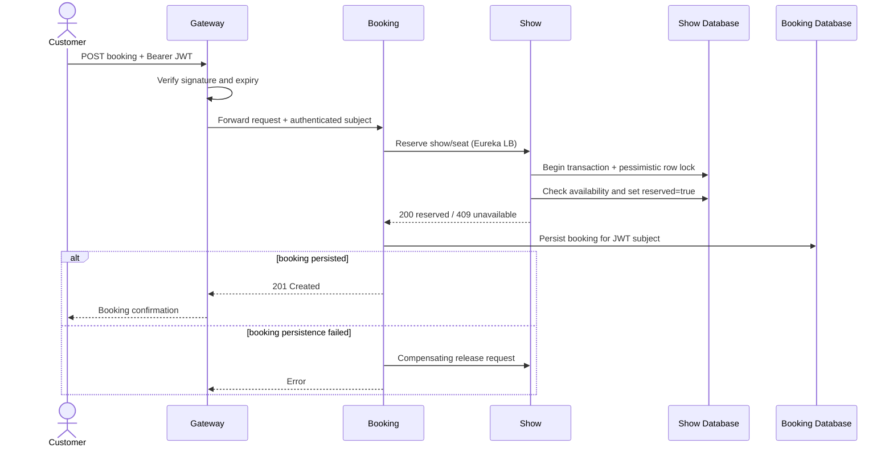
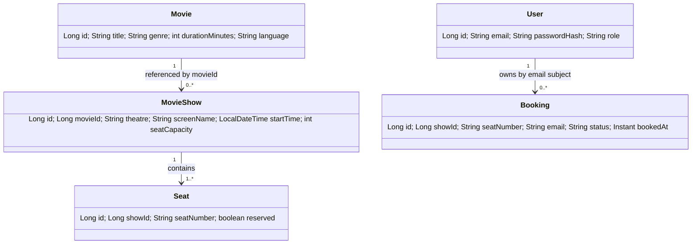

# UML and design diagrams

## Use-case diagram

## Booking sequence

## Domain class diagram

## Deployment architecture
See `ARCHITECTURE.md` for the deployment component diagram and service/database ownership.
